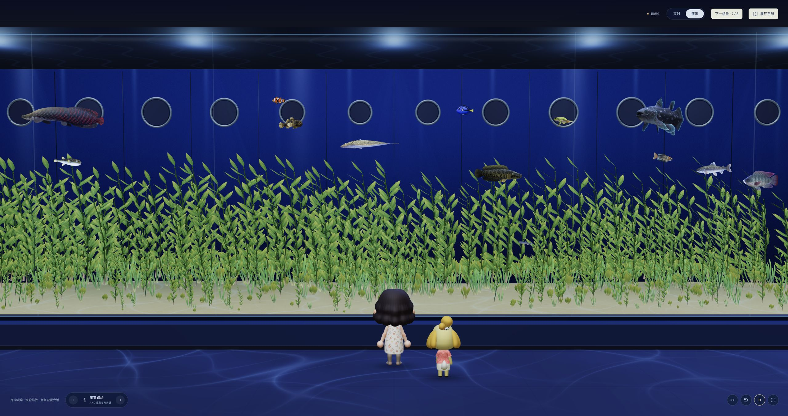

# Codex Aquarium · 摸鱼海洋馆

中文 · [English](README.en.md)

**Agent 工作，你来摸鱼。**

把 Codex 的活跃会话变成水族箱里的鱼群，和动森小动物一起，等 Agent 把工作做完。


*当前版本本地实景渲染，使用演示鱼群。*

- **实时鱼群**：运行中的会话是一只大鱼，工具和子 Agent 是随行小鱼。空闲时游离，继续同一会话还是原来那只。
- **自由巡游**：80 种动森鱼类模型，主鱼在全缸巡游、避让，不跟随人物；真实会话使用中大型鱼，演示可看全部种类。
- **结伴逛馆**：选择小女孩或小男孩，带上 482 位小动物中的一位，在水族箱前左右跑动、驻足看鱼。
- **六种造景**：完整造景、长叶草甸、珊瑚岛礁、静石浅滩、低草甸、清透裸缸；水草随水流轻摆。

<details>
<summary>看看长叶草甸</summary>



</details>

## 安装

需要 Node.js 22.12+、支持插件与 Hooks 的 Codex 桌面端、Codex CLI、Bash、curl、tar，以及支持 WebGL 2 的浏览器。macOS 已验证，Linux 待验证。

### 从 Codex 插件来源安装

先添加 GitHub 来源：

```bash
codex plugin marketplace add kinglisky/codex-aquarium --ref marketplace \
  --sparse .agents --sparse .codex-plugin --sparse dist \
  --sparse hooks --sparse server --sparse skills --sparse docs --sparse scripts
```

重启 Codex，在插件页面选择 **Codex Aquarium** 来源，安装鱼缸。首次安装后运行插件的 **Setup** 配置技能，或告诉 Codex「完成 Codex Aquarium 首次配置」，然后亲自审阅、信任 Hooks。市场包已预构建；请保留 `--sparse` 参数，避免克隆全部历史模型。

更新来源后，在 Codex 中更新插件：

```bash
codex plugin marketplace upgrade codex-aquarium-local
```

已用下方脚本安装的用户可继续原方式更新。如需切换来源，或之前添加来源时未使用 `--sparse`，先执行 `codex plugin marketplace remove codex-aquarium-local`，再用上面的命令添加。

### 让 Agent 安装

复制给本机 Codex：

```text
请安装或更新 Codex Aquarium：https://github.com/kinglisky/codex-aquarium
检查 Node.js 22.12+、Codex CLI、Bash、curl、tar 和 codex plugin add --help。
若 Node.js 缺失或过旧，提示我从 https://nodejs.org/ 安装。
在临时目录下载以下脚本，先阅读再执行 bash aquarium-install.sh：
(curl --http1.1 -fL -H 'Accept: application/vnd.github.raw+json' 'https://api.github.com/repos/kinglisky/codex-aquarium/contents/install.sh?ref=master' -o aquarium-install.sh ||
  curl --http1.1 -fL 'https://raw.githubusercontent.com/kinglisky/codex-aquarium/master/install.sh' -o aquarium-install.sh)
保留 SHA-256 校验，确认 codex-aquarium@codex-aquarium-local 安装成功。
在安装目录，用安装时的同一 Node.js 检查 server/cli.mjs status 和实际地址的 /api/health；macOS 另查自动启动配置。
提醒我重启 Codex、开启 Aquarium 技能，并亲自审阅和信任 Hooks，不替我确认。
信任后验证真实任务的主鱼与并发工具、子 Agent 小鱼，不用演示代替。
用现有默认浏览器打开鱼缸，报告插件 manifest 中的版本、安装目录和地址，不输出停止凭据。
```

### curl 快捷安装

```bash
(curl --http1.1 -fL -H 'Accept: application/vnd.github.raw+json' 'https://api.github.com/repos/kinglisky/codex-aquarium/contents/install.sh?ref=master' -o aquarium-install.sh ||
  curl --http1.1 -fL 'https://raw.githubusercontent.com/kinglisky/codex-aquarium/master/install.sh' -o aquarium-install.sh) && bash aquarium-install.sh
```

从 GitHub raw 安装预构建包并校验 SHA-256，无需本地编译；缺少合适的 Node.js 时提示安装并退出。升级也用同一指引或命令。安装目录默认是 `~/.codex/aquarium-install/codex-aquarium`（遵循 `CODEX_HOME`），请保留。

**轻量安装**：默认人物、西施惠、全部鱼类和造景随包提供。其他小动物在首次选用时下载并校验，缓存在本机，后续使用无需重复下载；未下载的旅伴需要联网，下载失败可重新选择重试。

## 开始摸鱼

1. 重启 Codex，在「自定义 → 插件 → Codex Aquarium」中开启 Aquarium 技能，点「钩子」齿轮，亲自审阅并信任 Hooks。
2. 完成首次配置后，macOS 打开 Codex 约 5 秒内静默启动服务；不会自动弹出页面。其他系统会在已信任的会话启动 Hook 触发时启动，也可用 `$aquarium` 打开。
3. 打开 **[本地海洋馆](http://127.0.0.1:43187/)**，地址以安装器输出为准。让 Agent 开始任务，鱼就会游进来；没有活跃任务时没有鱼，聚焦输入框不算活跃。

**语言**：首次打开跟随浏览器语言，支持中文与英文；右上角可切换，并记住你的选择。

**操作**：A / D 或左右键跑动，拖动观察，滚轮缩放，点鱼查看会话。「展厅手册」可切换人物、旅伴、造景与演示；原生全屏中，移动鼠标或按 Tab 唤出控件。

<details>
<summary>配置截图与常见问题</summary>


- **页面打不开**：先用 `$aquarium` 启动；macOS 自动启动失败时，在安装目录执行 `node server/autostart.mjs enable`。
- **任务运行却没有鱼**：检查 Hooks 信任与其 Node.js 路径，确认 `/api/state` 的 `lastEventAt` 随工具调用更新。页面打开不等于会话事件接通。
- **手动停止**：在安装目录执行 `node server/cli.mjs stop`。macOS 下本次 Codex 运行期间保持停止，完全退出再打开后恢复自动启动。
- **更换 Node.js 路径**：重新安装插件，并重新审阅、信任更新后的 Hooks。
- **GitHub API 限流**：安装入口和包下载会自动回退 raw，保留 SHA-256 校验。

</details>

仅接入本机会话，无需 API Key，不保存聊天内容、不扫描历史、不上传运行数据。

代码采用 [MIT 许可](LICENSE)；动森模型与贴图属于 Nintendo 等原权利人，详见[素材说明](public/models/acnh/NOTICE.md)。
