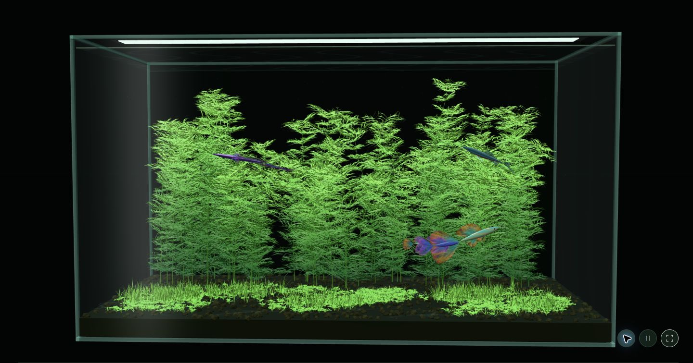
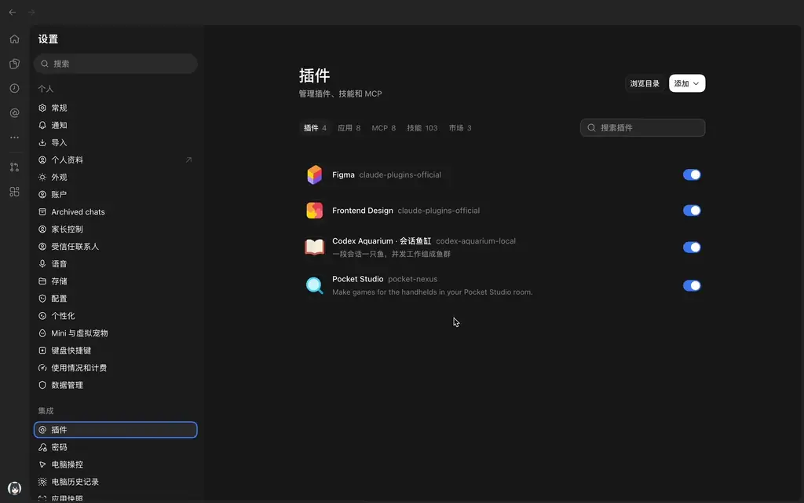
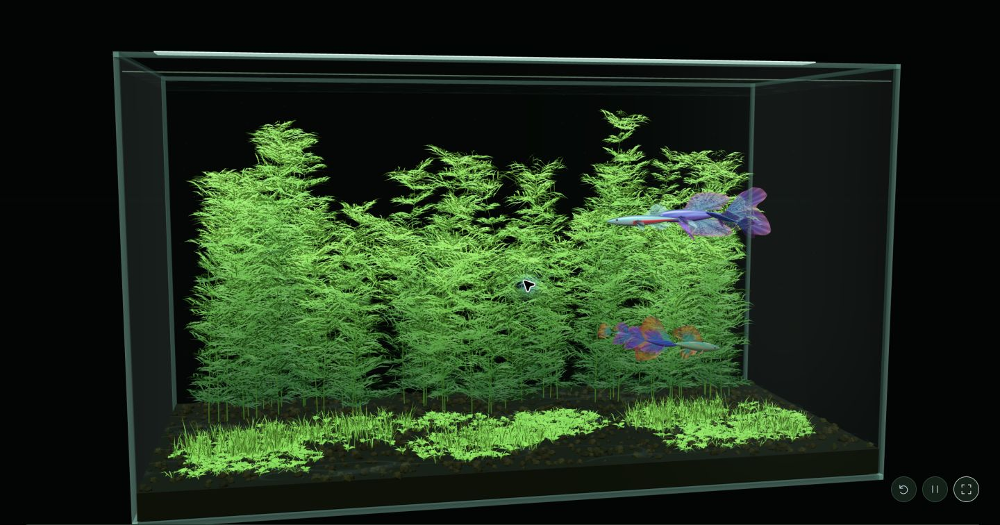
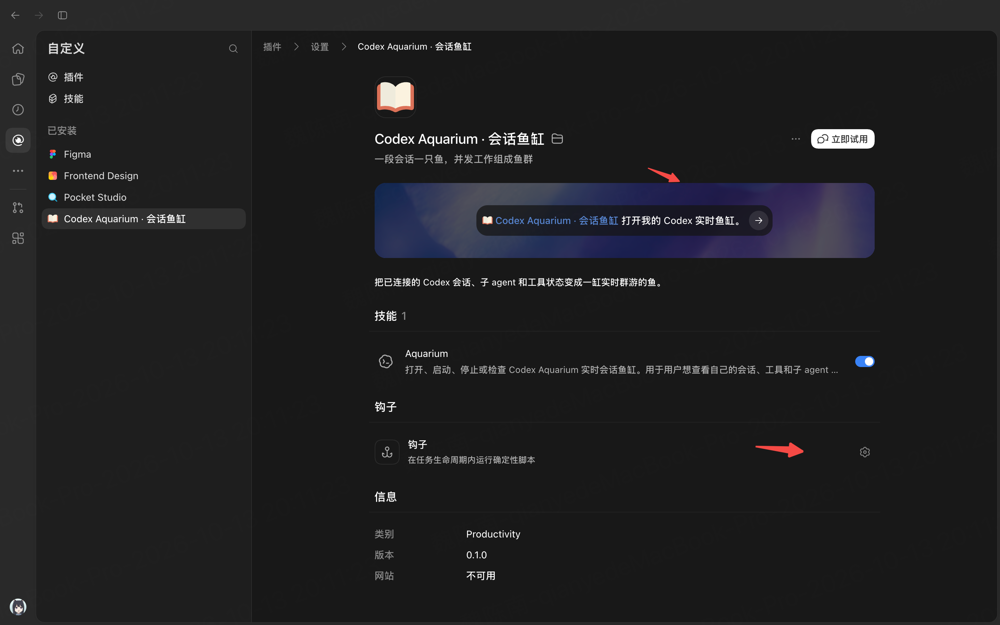

# Codex Aquarium · 泊

让工作，游起来。把 Codex 当前的会话、工具调用和子 agent，变成一缸实时游动的鱼。



上图直接截自本地运行的 WebGL 页面，鱼群来自已连接的 Codex 会话及并发活动。截图采用沉浸模式隐藏会话名称，没有使用生成图片或预渲染背景。

## 演示效果



动图在 README 中自动循环播放，已加速 4 倍，时长约 23 秒。WebP 分辨率为 1024 × 640，文件大小约 1.5 MiB。

[观看或下载高清演示视频（4 倍速，WebM，1920 × 1200，约 3 MiB）](docs/videos/demo-4x.webm)

## 鱼缸里有什么

- **一段活跃会话，一只主鱼**：思考、工作或等待时出现，所有活动结束后离开；继续同一会话时，原来的鱼会回来。
- **并发工作组成鱼群**：正在执行的工具和子 agent 是跟随的小鱼，完成后离开。
- **十种观赏鱼型**：霓虹灯鱼、孔雀鱼、燕尾斗鱼、红剑尾、蓝鳍虹鱼、金色长鳍、黑尾大勾、宝莲灯、虎皮和斑马。
- **可交互的 3D 草缸**：拖动环绕、滚轮缩放、点击鱼查看会话；可调灯光、水流，也可暂停游动或进入浏览器原生全屏。按 Esc 或再次点击全屏按钮退出，恢复页面布局。
- **本机运行**：无需 API Key，不上传会话信息，不扫描历史聊天。



两张截图均由正在运行的插件页面直接截取。玻璃、水面、水草与鱼均由 Three.js 实时渲染；宝塔草和前景草甸使用程序化三维几何。

## 安装条件

- 支持插件及生命周期 Hooks 的 **Codex 桌面端**。
- 命令行可用的 **Node.js 22.12+**、`codex`、`curl`、`tar` 和 Bash。
- 浏览器支持 WebGL 2。

使用发行包无需安装 pnpm、克隆源码或自行编译。当前桌面实测平台是 macOS；Windows 和 Linux 尚未完成真实 Codex 桌面安装验证。

## 快速安装

### 复制给 Codex 安装

把下面整段发送给本机 Codex agent，它会检查环境、下载安装并打开鱼缸。首次安装后，Hooks 仍需你本人在 Codex 中审阅并信任。

```text
请帮我在这台电脑安装或更新 Codex Aquarium，并验证安装成功。

官方仓库：https://github.com/kinglisky/codex-aquarium
安装脚本：https://api.github.com/repos/kinglisky/codex-aquarium/contents/install.sh?ref=master

请直接完成以下步骤：
1. 检查 Bash、curl、tar、Codex CLI 和 Node.js 22.12+；运行 codex plugin add --help，确认 CLI 支持插件安装。
   若没有 Node.js 或版本过低，提示我从 https://nodejs.org/ 安装 Node.js 22.12+，然后停止，不自动安装系统软件。
   其他依赖缺失时，说明具体缺项。
2. 在临时目录运行：
   curl -fL -H 'Accept: application/vnd.github.raw+json' 'https://api.github.com/repos/kinglisky/codex-aquarium/contents/install.sh?ref=master' -o aquarium-install.sh
   下载成功后先阅读 aquarium-install.sh，确认来自上述官方仓库。
3. 执行 bash aquarium-install.sh。
   脚本从 GitHub raw 文件下载同版本的预构建包并校验 SHA-256，随后安装插件并启动服务。
   遇到错误时报告原因，不跳过校验或改写信任记录。
4. 用 codex plugin list --json 确认 codex-aquarium@codex-aquarium-local 已安装。
   从安装器输出的安装目录运行 node server/cli.mjs status；若服务未运行，执行 node server/cli.mjs start。
   再检查实际服务地址的 /api/health。不要输出运行目录中的停止凭据。
5. 使用我现有的默认浏览器打开服务返回的本地地址，并告诉我安装版本、安装目录和鱼缸地址。
   默认地址通常为 http://127.0.0.1:43187，以实际输出为准。
6. 提醒我重启 Codex、启用 Aquarium 技能，并到“自定义 → 插件 → Codex Aquarium · 会话鱼缸 → 钩子”审阅并信任 Hooks。
   此步骤由我本人完成，不替我确认、不修改信任文件。
   完成后，让我继续一个会话触发工具调用，验证活跃主鱼和工具跟随鱼；全部活动结束后主鱼隐藏。
   继续同一会话应恢复原来的鱼。不要用演示鱼群冒充真实验证。

若 raw 文件下载失败或缺少必要权限，请清楚说明阻塞原因，不把未完成的安装报告为成功。
```

### curl 快捷安装

在 macOS / Linux 终端复制执行：

```bash
curl -fL -H 'Accept: application/vnd.github.raw+json' 'https://api.github.com/repos/kinglisky/codex-aquarium/contents/install.sh?ref=master' -o aquarium-install.sh && bash aquarium-install.sh
```

命令通过 GitHub 官方 raw API 读取仓库中的 [install.sh](install.sh)，只有下载成功才会执行。脚本从同一仓库的 `distribution` 分支下载预构建插件，校验 SHA-256 后安装并启动鱼缸，整个流程无需访问 Release 附件服务器。

缺少 Node.js 或版本低于 22.12 时，脚本会提示前往 [Node.js 官网](https://nodejs.org/) 安装，并退出。安装完成后重新执行上述命令即可。

默认安装源位于 `~/.codex/aquarium-install/codex-aquarium`；设置 `CODEX_HOME` 时使用对应目录。请保留该目录，后续更新仍会使用它。

## 信任并打开

1. 安装后重启 Codex 桌面端，让新插件加载。
2. 打开 **自定义 → 插件 → Codex Aquarium · 会话鱼缸**，确认 **Aquarium** 技能的开关已开启。
3. 点击「钩子」一栏右侧的齿轮，在设置中审阅并信任插件的 Hooks。CLI 也可通过 `/hooks` 打开审阅界面。
4. 点击页面上方的示例提示词 **“打开我的 Codex 实时鱼缸”** 或 **“立即试用”**；也可在会话中输入这句话或使用 `$aquarium`。
5. 让 Codex 执行工具调用，观察主鱼与跟随鱼。



上图为插件配置页面。下方红色箭头标出钩子设置入口，上方红色箭头标出打开鱼缸的示例提示词；技能开关开启后，仍需单独审阅并信任 Hooks。

默认地址是 [http://127.0.0.1:43187](http://127.0.0.1:43187)。安装器不会替用户确认信任、修改信任记录或绕过审批。新增或改动 Hooks 后，Codex 可能再次要求审阅。

## 更新与卸载

更新时再次发送上面的 [Codex 安装指引](#复制给-codex-安装)，或重新执行 [curl 快捷安装命令](#curl-快捷安装)。安装源会更新，成功安装后本地鱼缸服务会重新启动；用户运行数据与 Hooks 信任记录不会被安装器删除。

卸载前先在 Codex 中让 Aquarium 停止本地服务，再运行：

```bash
codex plugin remove codex-aquarium@codex-aquarium-local
codex plugin marketplace remove codex-aquarium-local
```

确认不再使用后，可自行删除安装源目录。运行数据保存在独立目录 `~/.codex/codex-aquarium`，卸载插件不会自动清除它。

## 实时状态边界

鱼缸只展示**已触发插件事件且处于思考、工作或等待状态的会话**（`thinking` / `working` / `waiting`），不是桌面侧栏所有打开的聊天。安装前已存在的会话需要继续运行并触发事件，才会进入鱼缸；是否活跃由真实事件判断，切换标签页不会改变状态。

发送消息时，主鱼进入鱼缸；等待权限时仍然保留。工具和子 agent 按各自 ID 加入、退出鱼群，完成后离开。主会话停止响应后，若仍有子 agent 运行，主鱼会继续保留；全部活动结束、进入空闲（`idle`）后隐藏。中断或会话结束时清理对应活动。继续同一会话时，主鱼按会话 ID 恢复相同鱼型和外观，不会重新抽取一只鱼。

服务重启后，已有会话暂时标为「状态过期」（`stale`）并隐藏，收到新的活跃事件后恢复。连续 30 分钟无事件也会标为过期并隐藏，24 小时无事件后移除状态记录。权限事件缺少调用 ID 时，会等待同名并发工具全部结束，避免提前显示权限已解决。

本地 Shell、`apply_patch`、MCP 和多数本地函数工具可被 Hooks 观察；托管 `WebSearch` 等工具不保证触发。工具鱼归属主会话，不假定 Hooks 能提供每个工具的子 agent 归属。远程或云端编排尚不在本版本支持范围内。

页面提供明确标注的「演示鱼群」用于预览；它与真实会话数据分开，实时模式不会为了填满鱼缸而虚构会话。

## 常见问题

| 现象 | 处理方式 |
| --- | --- |
| 鱼缸没有鱼 | 确认插件已启用、Hooks 已信任，并让一个会话继续工作；没有活跃会话时空缸是正常状态。 |
| 安装后仍是旧页面 | 刷新浏览器；确认更新安装成功并已重启本地鱼缸服务。 |
| 无法进入全屏 | 按页面提示，在支持全屏的浏览器中打开鱼缸，再点击全屏按钮。 |
| 工作结束或服务重启后鱼消失 | 空闲和状态过期的会话会隐藏；继续对应会话，收到新的活跃事件后会恢复原来的鱼。 |
| `codex` 命令不存在 | 安装或配置 Codex CLI，确认 `codex plugin add --help` 可用，再使用上述安装方式。 |
| 缺少 Node.js 或版本过低 | 按脚本提示安装 Node.js 22.12+，确认 `node --version` 可用后重新执行安装命令。 |
| raw 下载失败 | 确认终端能访问 `api.github.com`；404 表示对应版本的 raw 文件尚未发布，需由维护者修复。GitHub API 限流时稍后重试。 |
| SHA-256 校验失败 | 重新执行上述安装流程；若仍失败，请向维护者反馈，不跳过校验。 |

## 开发与构建

源码构建使用项目声明的 pnpm 版本。

```bash
git clone https://github.com/kinglisky/codex-aquarium.git
cd codex-aquarium
pnpm install --frozen-lockfile
pnpm package
```

`pnpm package` 执行测试和生产构建，输出预构建包、`install.sh`、内部安装组件和 `SHA256SUMS`。发行包包含已构建界面、服务端、Hooks、skill、截图文档与许可证，不包含 `node_modules`。

```bash
pnpm dev                    # 前端开发预览
pnpm check                  # 测试与生产构建
node server/cli.mjs start    # 从源码目录启动已构建的鱼缸
node server/cli.mjs status
node server/cli.mjs stop
```

以上命令用于开发和验证构建；日常安装和更新使用前述两种方式。

## 发布版本

同步修改 `package.json`、`.codex-plugin/plugin.json` 与 `install.sh` 中的版本，更新 [CHANGELOG.md](CHANGELOG.md)。构建并将 raw 文件发布到 `distribution` 分支后，再推送源码和对应标签：

```bash
pnpm package
pnpm publish:distribution
git tag v0.1.4
git push origin master v0.1.4
```

发布命令需要已登录且具有仓库写入权限的 GitHub CLI。每个版本发布到独立目录，已发布的同版本文件不能被覆盖。

含生命周期 Hooks 的插件目前适合 Codex 桌面端手动安装或 marketplace 分发，不能提交到官方公共插件目录。[官方打包说明](https://developers.openai.com/plugins/build/plugins) · [Hooks 与信任](https://learn.chatgpt.com/docs/hooks)

## 数据与隐私

采集器仅保留会话及调用 ID、事件类型、工具名称、agent 类型、时间等状态元数据。不保存提示词、回答、工具参数、工具输出或外部服务认证信息，不扫描历史会话，不向远程服务器发送运行数据。鱼缸服务只监听本机回环地址。

默认数据目录为 `${CODEX_HOME:-~/.codex}/codex-aquarium`。如设置 `AQUARIUM_DATA_DIR`，Hooks 和服务必须使用同一目录。服务的停止凭据仅保存在本机运行目录。

安装脚本联网仅用于读取官方仓库的 GitHub raw 文件。

## 许可证

[MIT](LICENSE)
