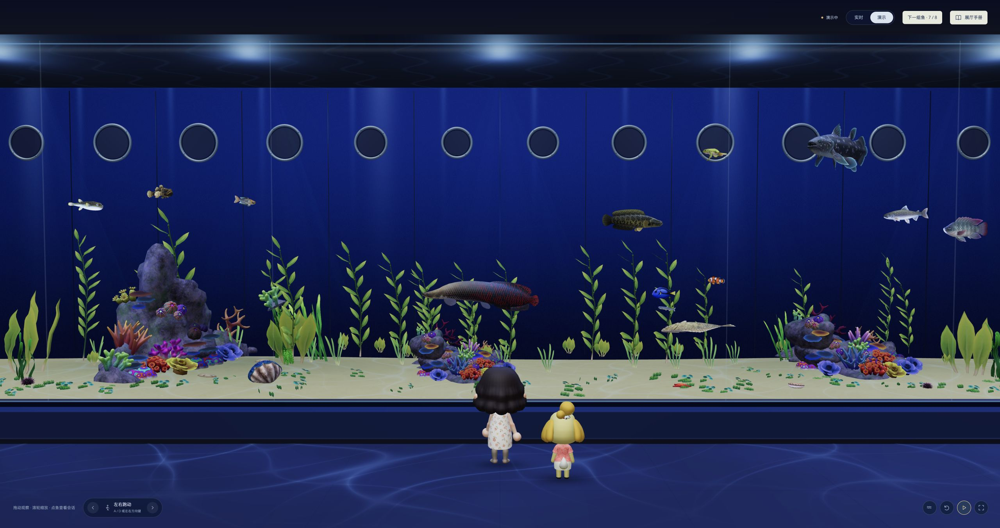

# Codex Aquarium · 泊

中文 · [English](README.en.md)

最近开始倒腾鱼缸，平时等待 agent 输出结果时很无聊，想着将 agent 会话映射成可视化的鱼缸。agent 工作，我摸鱼，刚好～

现在把鱼缸搬进了海洋馆：一个人站在巨大的水族箱前，看深蓝色水体里的鱼群，等 agent 慢慢把工作做完。展厅沿用动森水族馆的观赏视角，鱼和访客改为《集合啦！动物森友会》的原版模型与贴图，保留本项目制作的展厅、玻璃与水光。

**本地鱼缸：[http://127.0.0.1:43187/](http://127.0.0.1:43187/)**

macOS 自动启动配置成功后，打开 Codex，鱼缸通常 5 秒内在后台静默启动，无需发消息，也不会自动打开页面。地址以安装器输出为准。



截图使用演示鱼群，不代表真实会话状态。

一段活跃会话，一只鱼；并发工具和子 agent，是跟随的小鱼。工作结束后隐藏，继续同一会话还是原来那只。打开会话、切换标签或聚焦输入框不算活跃。共有 10 种由动森原版资源转换的 3D 鱼，没有活跃会话时，实时展厅里没有鱼。

按 A / D、左右方向键或页面上的左右按钮，让访客沿玻璃散步；点「靠近玻璃」切换近景。拖动换角度，滚轮缩放，点鱼查看会话；「展厅手册」里可以查看实时状态、海洋图鉴，调整灯光和水流。深蓝水体、顶部光束与地面焦散会缓慢流动，也能暂停游动或进入原生全屏。

<details>
<summary>旧版草缸截图与演示</summary>

以下是 0.1.x 草缸版本，保留作效果对照。


旧版 4 倍速演示，约 23 秒 · [高清 WebM 视频](docs/videos/demo-4x.webm)

</details>

当前接入大白鲨、鲸鲨、翻车鱼、皇带鱼、真鲷、凤尾鱼、管眼鱼、锦鲤、金鱼和竹荚鱼。模型保留原版网格、UV、骨骼与贴图，转换为内嵌纹理的 GLB；摆尾、转向和步行由程序驱动，并非游戏原始动画。访客服装使用原版版型和底纹，自定义蓝色配色。所有展示资源随本地页面加载，运行时无需连接素材网站。

鱼会根据相对速度提前减速，绕开其他鱼、玻璃和礁石；狭窄处先侧移或退让，腾出空间再转身。随行小鱼按体型保持间距。Rapier 物理引擎负责碰撞，鱼身与碰撞体同步转向；不同鱼种各有摆尾与鱼鳍动作，转弯时身体会柔和弯曲。

素材来自 [Models Resource](https://models.spriters-resource.com/nintendo_switch/animalcrossingnewhorizons/) 与公开的动森资源镜像；来源、转换说明和权利归属见 [模型说明](public/models/acnh/NOTICE.md)。游戏模型与贴图属于 Nintendo 等原权利人，不适用项目代码的 MIT 许可。

## 养一缸

需要支持插件与 Hooks 的 Codex 桌面端、Codex CLI、Node.js 22.12+ 和支持 WebGL 2 的浏览器。macOS 已实测，其他桌面平台待验证。

### 让 agent 安装

复制给本机 Codex：

```text
请帮我安装或更新 Codex Aquarium：https://github.com/kinglisky/codex-aquarium
检查 Node.js 22.12+、Codex CLI、Bash、curl 和 tar，确认 codex plugin add --help 可用。
Node.js 缺失或版本过低时，提示我从 https://nodejs.org/ 安装，不自动安装系统软件。
在临时目录下载；下载成功后先阅读脚本，再执行 bash aquarium-install.sh：
curl -fL -H 'Accept: application/vnd.github.raw+json' 'https://api.github.com/repos/kinglisky/codex-aquarium/contents/install.sh?ref=master' -o aquarium-install.sh
保留 SHA-256 校验，用 codex plugin list --json 确认 codex-aquarium@codex-aquarium-local 已安装。
使用成功运行安装器的同一 Node.js，在安装目录执行 server/cli.mjs status，检查实际地址的 /api/health；macOS 还要确认自动启动配置成功。
用现有默认浏览器打开鱼缸，告诉我版本、安装目录和地址，不输出停止凭据。
提醒我重启 Codex、开启 Aquarium 技能，并亲自审阅和信任 Hooks，不替我确认。
信任后验证真实会话的主鱼与并发工具、子 agent 跟随鱼；空闲时隐藏，继续同一会话恢复原来的鱼。
失败请说明原因，自动启动的验证结果单独说明，不用演示鱼群代替验证。
```

### 或者 curl 安装

在 macOS / Linux 终端执行：

```bash
curl -fL -H 'Accept: application/vnd.github.raw+json' 'https://api.github.com/repos/kinglisky/codex-aquarium/contents/install.sh?ref=master' -o aquarium-install.sh && bash aquarium-install.sh
```

从 GitHub raw 文件安装预构建包并校验 SHA-256，无需本地编译。Node.js 缺失或版本过低时会提示安装并退出。旧版本也用上面的指引或命令升级，v0.1.5 起会配置 macOS 自动启动，保留运行数据和 Hooks 信任记录。

安装目录默认是 `~/.codex/aquarium-install/codex-aquarium`，设置 `CODEX_HOME` 时使用对应目录，请保留它。若提示自动启动配置失败，在安装目录执行 `node server/autostart.mjs enable` 重试；下载遇到 GitHub API 限流时稍后再试，不跳过 SHA-256 校验。

安装器会把 Hooks 固定到本次安装成功运行的 Node.js，避免后台调用其他损坏的 Node.js。更换 Node.js 安装位置后，请重新安装插件；解释器路径改变时，需要在 Codex 中重新审阅并信任 Hooks。

## 接上会话

重启 Codex →「自定义 → 插件 → Codex Aquarium · 会话鱼缸」→ 开启 Aquarium 技能 → 点「钩子」齿轮，审阅并信任 Hooks。


然后打开上方本地链接，让 agent 开始工作。也可以用 `$aquarium` 打开页面；Linux 需要先用它启动服务。

macOS 上手动停止鱼缸后，本次 Codex 运行期间会保持停止，完全退出并重新打开 Codex 才会再次自动启动。空鱼缸通常表示没有活跃会话；确认 Hooks 已信任，再继续会话并触发一次工具调用。

若任务正在运行却没有鱼，请检查 Hooks 是否已信任、命令中的 Node.js 绝对路径是否仍能运行，以及 `/api/state` 的 `lastEventAt` 是否随工具调用更新。网页能打开只代表服务已启动，不代表会话事件已接通。

只接本机会话，无需 API Key，不保存聊天内容，不扫描历史，也不上传运行数据。

<details>
<summary>停止与卸载</summary>

仅停止鱼缸，在安装目录执行 `node server/cli.mjs stop`。卸载时先关闭后台启动项并停止服务，再移除插件：

```bash
aquarium_root="${CODEX_HOME:-$HOME/.codex}/aquarium-install/codex-aquarium"
node "$aquarium_root/server/autostart.mjs" disable
node "$aquarium_root/server/cli.mjs" stop
codex plugin remove codex-aquarium@codex-aquarium-local
codex plugin marketplace remove codex-aquarium-local
```

之后可以删除安装目录；运行数据不会自动删除。

</details>

[更新记录](CHANGELOG.md) · [代码许可：MIT](LICENSE) · [游戏素材说明](public/models/acnh/NOTICE.md)
